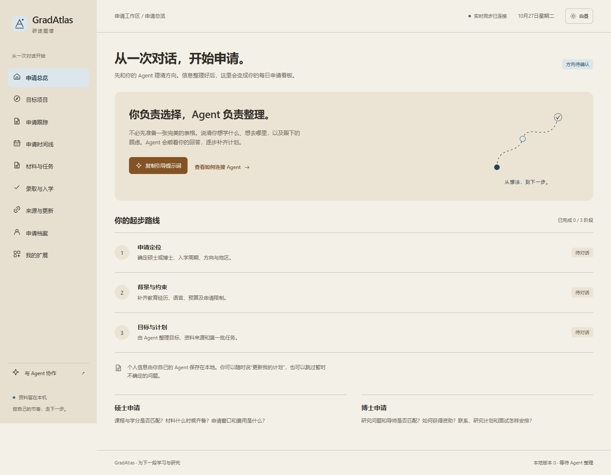
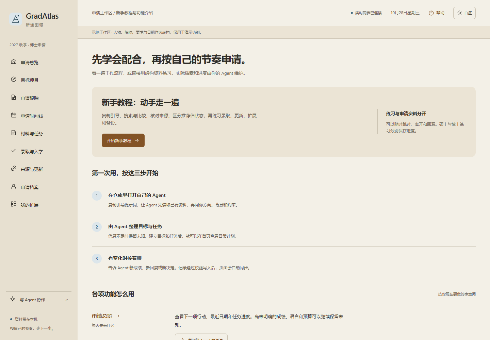
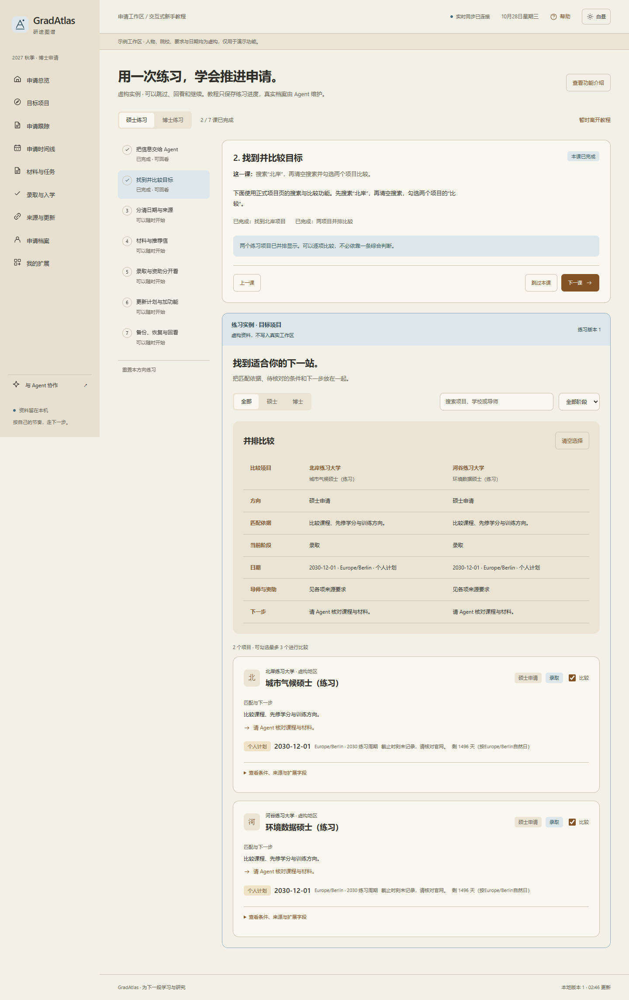
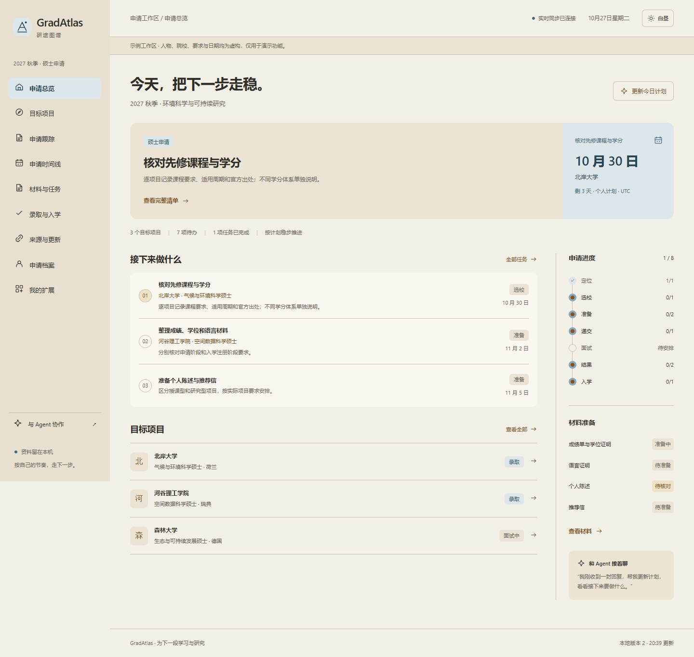
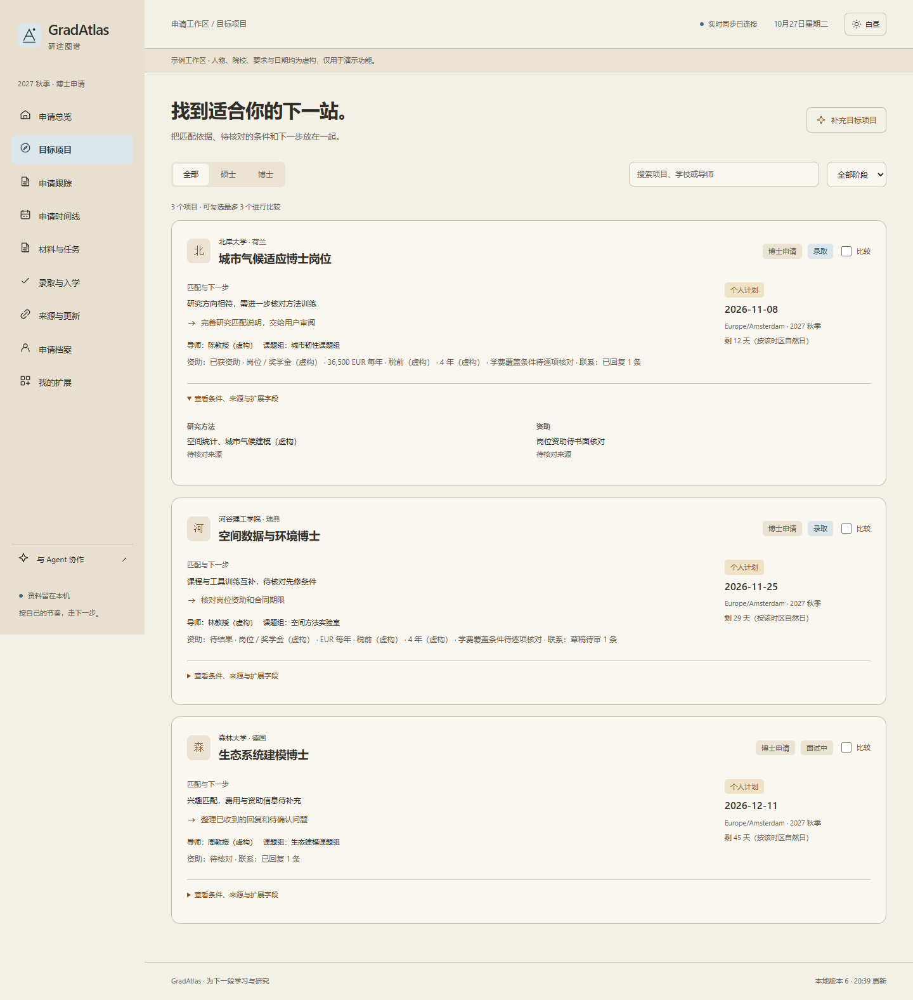
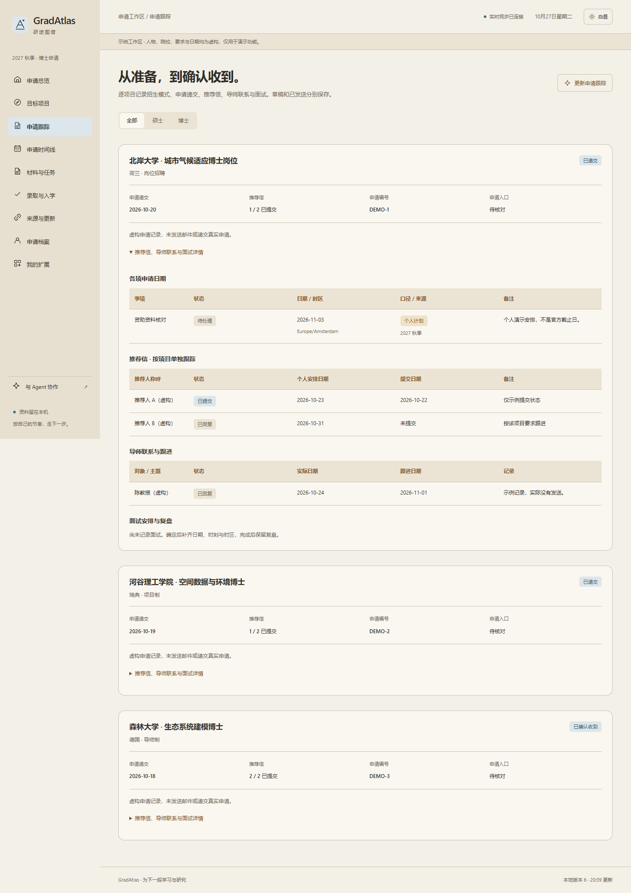
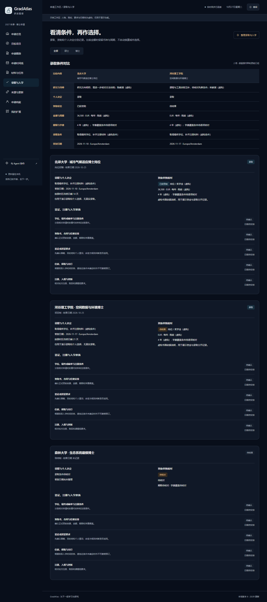

# GradAtlas · 研途图谱

和 Agent 一起整理研究生申请：先通过对话理清背景、目标和约束，再把项目、材料、待办和时间放到同一个工作区。支持硕士与博士，不限学科、地区或入学年份。

**信息由 Agent 整理和更新，网页展示申请计划。** 你可以直接说“我的语言成绩出来了”“帮我核对这些导师的资助”“加一份奖学金跟踪表”，由自己的 Agent 完成配置。



## 开始使用

需要按步骤操作时，见[中文安装与首次使用教程](docs/INSTALL.zh-CN.md)；公测附件从[GitHub Release](https://github.com/AL1ghtm3ter/grad-atlas/releases/tag/v1.3.1)下载，测试记录见[中文报告索引](docs/qa/README.md)。

先准备 Git 和 Node.js 22.21+（22.x）或 24.5+。尚未安装时，从 [Git 官网](https://git-scm.com/install/)和 [Node.js 官网](https://nodejs.org/en/download)选择系统对应的安装程序；Node.js 选符合上述版本的 LTS。安装后重新打开终端，运行 `git --version`、`node --version` 和 `npm --version`，确认工具可用。程序不依赖第三方运行时软件包，无需先安装 npm 包。可选的公开网页阅读回退会调用 Jina 服务，默认关闭。

```sh
git clone https://github.com/AL1ghtm3ter/grad-atlas.git
cd grad-atlas
npm start
```

保持这个终端运行，打开启动输出显示的地址；默认是 `http://127.0.0.1:4680/`。Ctrl+C 停止服务。首次打开会显示三步引导：申请定位、背景与约束、目标与计划。建立目标项目与任务后，首页显示每天需要关注的内容；仍未知的成绩、语言或预算可以留待后续整理。

端口被占用时，PowerShell 可运行 `$env:GRAD_ATLAS_PORT=4685; npm start`，macOS/Linux 可运行 `GRAD_ATLAS_PORT=4685 npm start`，也可使用 `npm start -- --port 4685`。以这次启动输出的地址为准，不继续打开旧端口。个人记录保存在同一项目目录，不随端口或浏览器变化。

另开一个终端，或让编码 Agent 打开刚克隆的 `grad-atlas` 目录，执行下面的技能安装和资料配置。运行服务的终端与 Agent 应指向同一份克隆；不要在父目录执行配置命令。

## 新手教程与功能介绍

进入当前工作区后，点击右上角“帮助”打开功能介绍，再选择交互式教程。这些入口跟随当前端口，路由分别为 `/#guide` 和 `/#tutorial`。教程包括复制 Agent 引导、搜索和比较项目、核对来源、跟进推荐信，以及录取、更新、扩展和备份练习。

七课都可以跳过、回看或中途退出，硕士与博士分别保存进度。练习使用独立虚构资料，复用正式页面的搜索、比较与记录展示；不会修改你的申请档案。填写与更新真实资料时，仍由自己的 Agent 完成。[教程说明](docs/TUTORIAL.md)列出了每课操作和功能入口。





## 把第一轮对话交给 Agent

在仓库目录打开你自己的编码 Agent，复制这段话：

> 请阅读 AGENTS.md 和 skills/grad-apply-onboarding/SKILL.md，引导我配置 GradAtlas。先检查已有记录，再分轮问我申请方向、背景、目标和约束。硕士和博士分别处理；配置由你整理，不让我手工填写 JSON。保留未知项，写入前校验版本和内容，更新后检查网页同步。

引导技能参考分轮追问的方式：先确认影响后续选择的条件，每轮通常问 1–3 个问题，再根据回答继续。已经明确的资料不会反复询问，暂时不知道的内容可以跳过。

- **Codex**：在另一个终端的同一克隆目录运行 `npm run install:skill`，再通过技能选择器或 `$grad-apply-onboarding` 使用。技能未出现在当前客户端时，重新载入或重启客户端；也可直接让 Agent 阅读仓库里的 `skills/grad-apply-onboarding/SKILL.md`。
- **Claude Code**：仓库附带 `/grad-apply` 命令，支持附上本次想补充的背景或变化。
- **其他编码 Agent**：直接阅读 SKILL.md，按其中的本地命令维护记录。

程序不自带模型账号或聊天服务。使用你已经配置好的 Agent；公开仓库中没有模型凭据。

安装脚本会显示技能目录，读取 `CODEX_HOME`，未设置时使用用户目录中的 `.codex/skills`。已有同名技能时会报错并保留原文件；先检查差异，也可直接使用本仓库里的技能，不需要删除已有副本。技能目录存放操作说明，个人申请信息仍只写当前克隆的 `.local/`。

## 硕士和博士各自需要什么

| 申请方向 | 主要信息与行动 |
| --- | --- |
| 硕士 | 授课型或研究型、先修课程与学分、成绩与语言、申请和注册材料、推荐信、个人陈述、申请窗口、学费与生活费 |
| 博士 | 研究问题与方法、科研经历与成果、导师和课题组、项目制或岗位制、资助、研究计划、联系进度、推荐信与面试 |

可以同时管理两类申请。博士的导师意向、正式录取和资助结果分别记录；硕士的学分匹配、材料准备和官方资格也分别处理。

硕士目标与录取可以并排查看课程与先修、学费、学期杂费、生活费和申请费。Agent 可继续添加保险、定金或语言证据等项目字段，比较时缺项保留待核对，金额与学分保持原口径。

申请跟踪覆盖项目制、岗位招聘与导师制，分别记录网申、逐项目推荐信、联系与面试。收到结果后，可以比较录取条件、原币种资助和答复安排，记录接受、婉拒、撤回，并继续跟进学位材料、签证或居留、住宿和注册入组。每个项目可有多项独立截止日，保留各自来源和时区。









## 运行示例

```sh
npm run demo
# 硕士示例：http://127.0.0.1:4681/

npm run demo:phd
# 博士示例：http://127.0.0.1:4682/
```

示例端口被占用时，可分别运行 `npm run demo -- --port 4686` 或 `npm run demo:phd -- --port 4687`，并按启动输出打开。个人工作区和两类示例使用同样的优先顺序：显式 `--port`、`GRAD_ATLAS_PORT`、各自默认值；示例不会覆盖个人档案。

默认演示与教程中的人物、院校、条件、联系状态和日期均为虚构。演示和个人工作区使用独立目录。本文图片来自实际运行的示例页面。

另附[真实博士项目研究基线](examples/real-phd-research-20261028.json)，使用莱顿、牛津、MIT、普林斯顿官网的岗位与学术要求，核验于 2026-10-28。它用于测试真实招生规则，不会替换你的工作区，也不包含实际递交、面试或录取记录。使用前须再次核对官网；[研究记录](docs/research/README.md)保留了来源、周期、冲突和未知项。

[真实硕士研究基线](examples/real-master-research-20261028.json)另含 Leiden、ETH、Oxford 和 Columbia 的四个独立硕士候选，共 52 个官方来源、114 项事实。Columbia 候选为物理基础与哲学交叉方向，须由用户确认兴趣后再纳入计划；普通 Physics MA 与 MIT Physics SM 的独立招生限制作为排除用例保留。该文件也不包含个人递交或录取。

界面提供暖纸色白昼与深蓝色夜间两套配色，可以跟随系统，也可以在右上角切换。支持桌面和手机布局、项目搜索、阶段筛选及最多三个项目的并排比较。

## 更新如何显示

Agent 校验并写入本地记录后，网页通过 SSE 自动同步；连接恢复时重新读取最新记录，文件观察有定时兜底检查。

官网检查另行处理：首次建立文本基线，之后记录变化或读取失败。变化不会自动写成新的申请要求，也不会替你确认资格。Agent 核对官方正文、适用周期和日期后，再更新事实。需要定时检查时，告诉 Agent 你希望的频率；本地服务运行期间才会执行。

详见 [数据与迁移](docs/DATA.md)、[来源核验](docs/SOURCES.md)。

## 添加自己的功能

向 Agent 描述你想看什么，例如：

> 我想按导师记录研究匹配、联系进度、上次回复和下一次跟进。请把它加到我的工作区，并保留现有申请数据。

简单需求可以通过自定义字段和扩展表直接显示；更复杂的交互可以修改源码模块。数据与程序分开维护，扩展说明见 [EXTENDING.md](docs/EXTENDING.md)。项目使用 MIT 许可，可以修改、再分发或贡献通用功能。

## 数据留在哪里

个人档案、任务、申请记录、官网观察和备份都在 `.local/`，该目录被 Git 忽略。公开构建只读取程序和虚构示例，源码包按允许发布的文件清单生成。截图也需要确认内容后再提交。

每次写入都检查当前版本并保存旧记录；版本冲突时需要重新读取和合并。文件损坏或校验失败会报错并保留原文件。迁移时复制私人 `.local/`，恢复前由 Agent 检查差异。不要把私人备份放进公开 Issue 或仓库。

服务只监听 `127.0.0.1`。可以在自己的工作台中配置本地入口，GradAtlas 的数据和运行仍由独立项目维护。

## 测过哪些流程

1.0.0 使用虚构院校和背景完成初版验收：QMUL 理论物理硕士在读，申请欧洲与美国博士。第一轮 57 项检查发现 5 个缺陷和 2 组缺失；补齐原生全周期功能后，第二轮又发现并修复 3 个跨页面一致性问题。

初版 93 项不同检查通过，其中 78 项完整流程在两个全新工作区分别重跑通过；当时有 28 项自动化回归。详细问题与修复见 [第一轮报告](docs/qa/round-1.md) 和 [第二轮报告](docs/qa/round-2.md)。

1.1.0 在 2026-10-28 改用莱顿、牛津、MIT、普林斯顿的真实官网岗位与学术要求，整理 36 个来源和 71 项事实。测试发现并修复了联系型推荐人被误报为缺交信件的问题；该版本在两个全新工作区各跑完 55 项全周期检查，全部通过。新增教程的 70 项检查及该版 39 项自动测试也全部通过。

全周期覆盖准备、逐项目推荐、联系、递交、面试、录取与资助、个人选择、入学准备、实时同步、来源检查、扩展、备份和手机布局。招生事实来自实际核验，个人递交、回复、结果与入学事件仅在本地模拟，未发送邮件或操作真实申请账户。[真实院校报告](docs/qa/real-applications-20261028.md)和[教程报告](docs/qa/tutorial-20261028.md)分别记录操作与边界。

1.1.0 当时的本地检查器只直接读到莱顿；牛津返回403，MIT与普林斯顿超时。1.2.0 修复了地址回退和代理使用，并加入可配置的公共阅读通道：直连优先，受限时经 Jina 请求重新抓取正文，核对来源URL、上游状态及挑战页。每次观察保留实际读取通道，切换通道时重新建基线，避免误报格式变化。

1.2.0 的自动正文复测覆盖四校各一个主页面，冷启动 CLI 连续检查两次，均为零读取错误；莱顿直连成功，牛津、MIT、普林斯顿经 Jina 取得正文。两轮完整申请流程各 63 项、教程 70 项、自动回归 51 项及来源页 4 项检查全部通过。36 个公开来源和 71 项招生事实保留原有核验记录，不因网页读取成功而改写。

让 Agent 在本地配置 `settings.sourceReader: "jina"` 即可启用；改为 `"off"` 关闭。该选项只发送无查询参数的公开网址，不发送档案、Cookie或登录信息。网络代理沿用当前进程的标准环境变量，不修改系统配置。[读取方式与配置](docs/SOURCES.md)、[修复及完整复测](docs/qa/fetch-repair-20261028.md)分别说明实现和实际结果。

1.3.0 使用四个真实硕士候选，从空工作区的八轮中文 Agent 引导开始，在同一份档案和版本记录上走完选校、逐项目材料、递交、录取、条件补件及入学。初查发现硕士仍用博士提示、课程与费用分项无法比较等问题；修复后，在两个全新工作区各跑完 69 项检查，全部通过。该版 57 项自动回归和教程 70 项检查也全部通过。

两轮都实际重读四个代表官网页面，确认取得正文；没有宣称 52 个来源都能自动抓取。招生规则来自官网，个人背景回答、推荐信、递交、录取和入学事件均为隔离环境中的模拟。操作、失败证据和修复范围见[中文硕士完整测试报告](docs/qa/masters-lifecycle-20261028.md)。

从 GitHub 重新克隆、照中文 README 安装并使用 SKILL 的硕博首次使用验收，另见[中文新用户报告](docs/qa/clean-install-20261028.md)。它与既有开发目录的测试分开记录。

## 开发与构建

```sh
npm test
npm run build
npm run check:public
npm run package
```

`dist/` 是只含虚构硕士数据的静态示例。运行 `npm run preview` 后按启动输出打开，默认 `http://127.0.0.1:4683/`；也可以在站点根路径通过 HTTP 托管。个人工作区与实时维护使用 `npm start`。不支持直接双击 HTML 文件。

`release/` 中的源码包包含程序、文档、技能、测试和示例，不包含 `.local/`、`.runtime/`、运行时或模型账号。

可编辑入口：`src/` 页面、`lib/` 数据与存储、`scripts/` 服务与 Agent 命令、`skills/` 引导技能。参与改进前请读 [AGENTS.md](AGENTS.md) 和 [CONTRIBUTING.md](CONTRIBUTING.md)。
